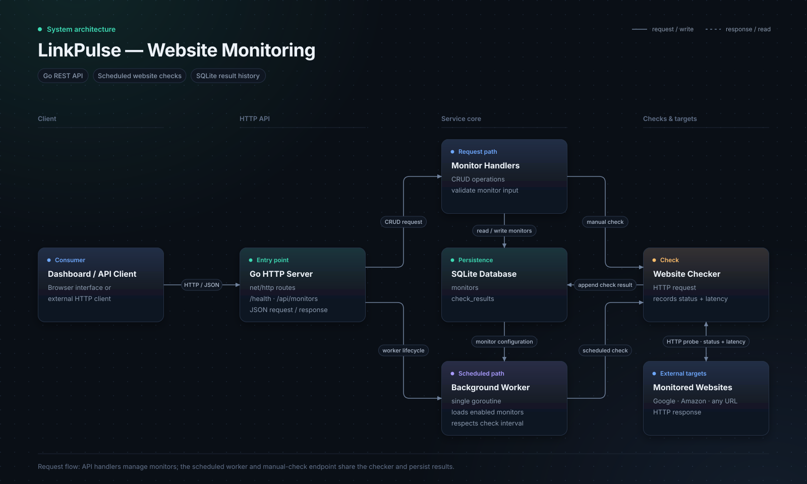
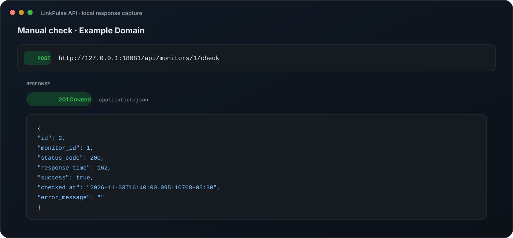
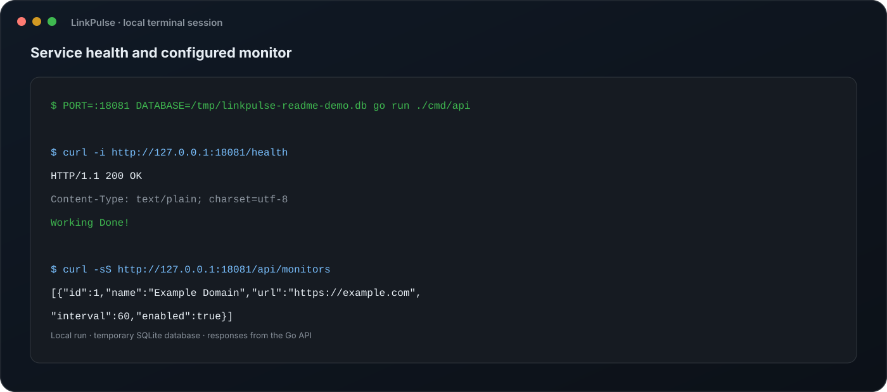
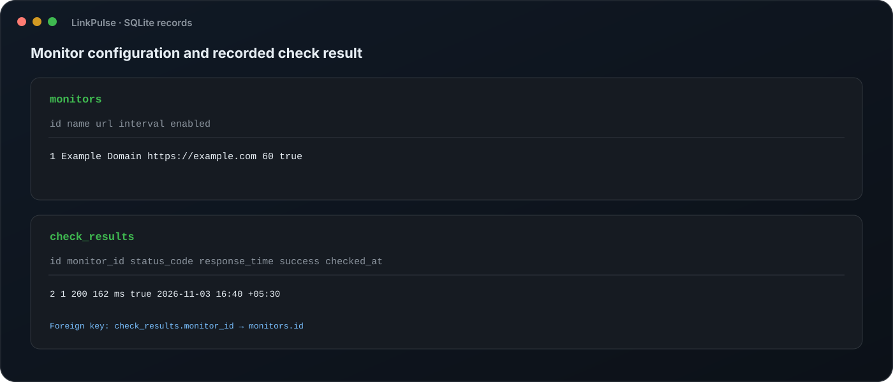

# 🚀 LinkPulse – Website Monitoring Tool

LinkPulse is a backend website monitoring service built with **Go** and **SQLite**. It checks website availability on a schedule, records response metrics, and exposes a RESTful API for managing website monitors.

It runs a background worker goroutine alongside the HTTP server, shuts down gracefully, and is built mainly on Go's standard library with a clean modular layout.

---

## ✨ Features

- Website monitor CRUD operations
- Automatic background monitoring in a worker goroutine
- Configurable monitoring interval for each website
- Enable or disable monitors
- Track HTTP response time
- Record HTTP status codes and error messages
- Store monitoring history
- Manual check endpoint
- SQLite persistence with foreign keys, WAL mode and an index for the scheduler query
- RESTful API
- Graceful shutdown: stops the worker and HTTP server, then closes the database
- Multi-stage Docker build
- Clean and modular project architecture

---

## 🛠 Tech Stack

| Technology | Purpose |
|------------|---------|
| Go | Backend development |
| SQLite | Database |
| modernc.org/sqlite | SQLite driver (pure Go, no CGO) |
| net/http | HTTP server and client |
| Goroutines | Background monitoring |
| Docker | Multi-stage build |

---

## 📂 Project Structure

```text
cmd/
└── api/
    └── main.go        # entry point, startup and graceful shutdown

internal/
├── checker/           # one HTTP check + background worker
├── config/            # environment configuration
├── db/                # connection, schema, queries
├── handlers/          # HTTP handlers
├── models/            # Monitor, CheckResult
└── server/            # routes and http.Server

docs/                  # architecture diagram, example output
Dockerfile
```

---

## ⚙️ Getting Started

### Clone Repository

```bash
git clone https://github.com/yashG0/linkpulse-website-monitoring-tool.git
cd linkpulse-website-monitoring-tool
```

### Install Dependencies

```bash
go mod tidy
```

### Configure Environment

Create a `.env` file (or export the variables):

```env
PORT=:8080
DATABASE=linkpulse.db
```

| Variable | Required | Description |
|----------|----------|-------------|
| `PORT` | yes | Listen port, with or without the leading `:` |
| `DATABASE` | yes | SQLite file path |

### Run the Application

```bash
go run ./cmd/api
```

Server starts on:

```
http://localhost:8080
```

### Run with Docker

The image does not include a `.env` file, so pass the configuration explicitly. Mount a volume so the database survives container removal:

```bash
docker build -t linkpulse .
docker run --rm -p 8080:8080 \
  -e PORT=8080 \
  -e DATABASE=/data/linkpulse.db \
  -v linkpulse-data:/data \
  linkpulse
```

---

## 📡 API Endpoints

| Method | Endpoint | Description | Success |
|---------|----------|-------------|---------|
| GET | `/health` | Health Check | 200 |
| POST | `/api/monitors` | Create Monitor | 201 |
| GET | `/api/monitors` | Get All Monitors | 200 |
| GET | `/api/monitors/{id}` | Get Monitor | 200 |
| PUT | `/api/monitors/{id}` | Update Monitor | 204 |
| DELETE | `/api/monitors/{id}` | Delete Monitor (and its results) | 204 |
| POST | `/api/monitors/{id}/check` | Trigger Manual Check | 201 |

### Example Request

```http
POST /api/monitors
```

```json
{
  "name": "Google",
  "url": "https://google.com",
  "interval": 60,
  "enabled": true
}
```

Notes:

- `name` and `url` are required; unknown JSON fields are rejected.
- `enabled` defaults to `false` if omitted. Only enabled monitors are checked automatically.
- `interval` is in seconds. The worker looks for due monitors every 5 seconds, so 5 seconds is the effective minimum.

---

## 🗄 Database Schema

### monitors

| Column | Type |
|--------|------|
| id | INTEGER PRIMARY KEY |
| name | TEXT |
| url | TEXT (unique) |
| interval | INTEGER (seconds) |
| enabled | BOOLEAN |

### check_results

| Column | Type |
|--------|------|
| id | INTEGER PRIMARY KEY |
| monitor_id | INTEGER (FK → monitors, `ON DELETE CASCADE`) |
| status_code | INTEGER |
| response_time | INTEGER (ms) |
| success | BOOLEAN |
| checked_at | DATETIME |
| error_message | TEXT |

An index on `(monitor_id, checked_at DESC)` serves the worker's "when was this monitor last checked" query.

---

## 🏗️ System Architecture

The Go HTTP server exposes health and monitor-management routes. Monitor handlers manage configuration in SQLite, while the background worker checks enabled sites according to their configured intervals. Manual checks use the same checker; both paths record status, latency, and errors in the check history.

<p align="center">
  
</p>

The scheduled worker runs as a single background goroutine. It wakes every 5 seconds, checks the monitors that are due, one after another, and stores each result. This keeps the design simple and avoids database write contention. The trade-off is that one slow site delays the others in the same round. A worker pool is the planned next step.

On shutdown, the signal cancels a context, the worker stops, the HTTP server drains in-flight requests (up to 5 seconds), and only then is the database closed.

---

## 📸 Example Output

Example output from a local run using a temporary SQLite database and an `Example Domain` monitor. Response times and timestamps vary between runs.

### API Response

A manual check returns the HTTP status, response time, success state, and check timestamp as JSON.

<p align="center">
  
</p>

### Terminal Session

The health endpoint and monitor list were queried from the running Go service. Successful background checks are quiet; the worker writes logs when it encounters errors or shuts down.

<p align="center">
  
</p>

### SQLite Records

The database stores monitor configuration separately from each recorded check result, linked by `monitor_id`.

<p align="center">
  
</p>

---

## ⚠️ Known Limitations

This is a learning project, and these are the known gaps:

- **No authentication.** Anyone who can reach the API can create monitors. Do not expose it publicly as is.
- **No URL validation.** A monitor can point at internal addresses (SSRF risk).
- **No read endpoint for check history yet.** Results are stored in SQLite but can only be inspected through the database, and uptime percentage is not computed.
- **Sequential checks.** One slow site delays the others in the same round.
- **Single node, SQLite**, and old check results are never pruned.
- **Logging is plain `log` output**, not structured.

---

## 🎯 Why I Built This

I built **LinkPulse** to strengthen my understanding of backend development in Go, REST API design, background workers with goroutines, graceful shutdown, and database-driven applications.

Instead of relying on third-party web frameworks, the project focuses on building maintainable backend services using Go's standard library and clean project organization.

---

## 🚀 Future Improvements

- Worker pool for concurrent checks
- `GET /api/monitors/{id}/results` with uptime and latency stats
- URL and interval validation
- JWT authentication and rate limiting
- Structured logging with `log/slog`
- Unit & integration tests
- Email notifications
- Prometheus metrics
- PostgreSQL support
- Dashboard frontend

---

## 👨‍💻 Author

**Yash Gaurkar**

- GitHub: https://github.com/yashG0
- LinkedIn: https://linkedin.com/in/yash-gaurkar-a897b3228
- Portfolio: https://portfolio.yashgaurkar.me